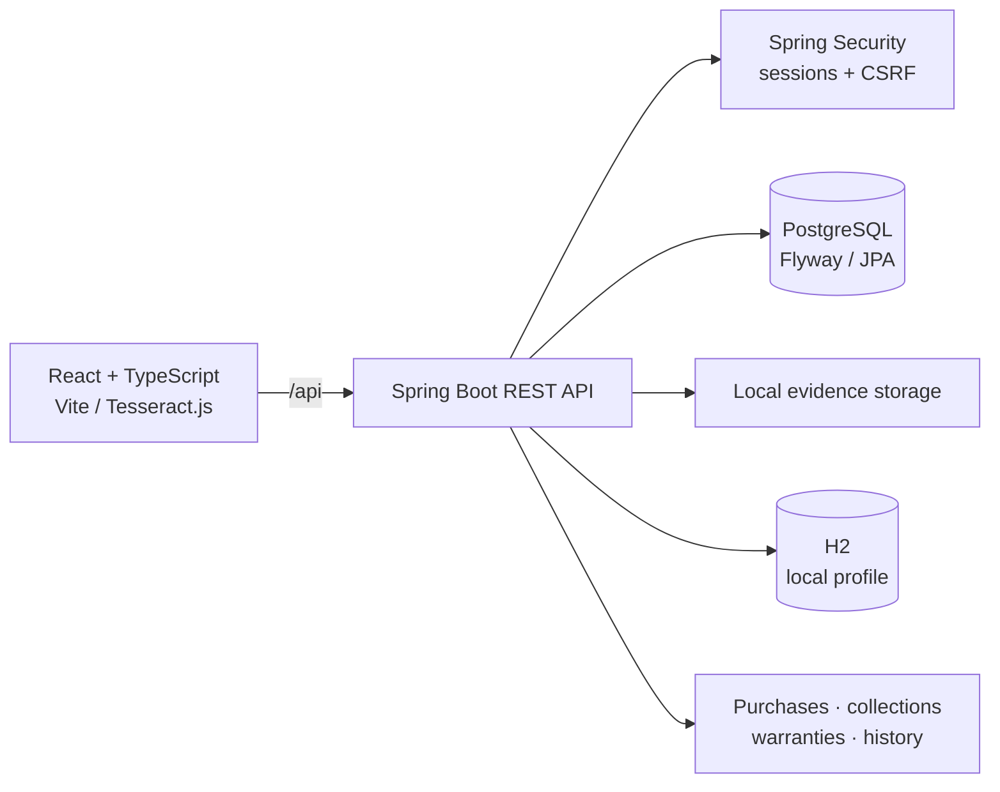

# Proofly

Proofly keeps purchase records, receipt evidence, product details, and warranty information together in a private, searchable vault.

## Features

- Create an account with session-based authentication, or use the local demo account.
- Add purchases manually or upload receipt images and review browser-based OCR suggestions.
- Store product identifiers, warranty coverage, return dates, and supporting documents.
- Search and filter purchases; view warranty status and purchase history.
- Organize purchases into collections and view purchases grouped by store.
- Export purchase data as CSV and warranty reminders as an iCalendar (`.ics`) file.

## Tech Stack

- **Frontend:** React 19, TypeScript, Vite, TanStack Query
- **Backend:** Java 21, Spring Boot 3.4, Spring Security, Spring Data JPA
- **Database:** PostgreSQL 16 with Flyway; in-memory H2 for local development
- **OCR and files:** Tesseract.js in the browser; local filesystem storage for uploaded evidence
- **Containers:** Docker Compose, Nginx

## Architecture

The React client communicates with the Spring Boot REST API through `/api`. During development Vite proxies these requests; the containerized frontend uses Nginx to proxy them to the backend. The backend persists account and purchase data through JPA, with Flyway migrations for PostgreSQL. Uploaded evidence is stored separately from its database metadata.



**Data model:** Accounts own purchases, collections, warranty reminders, and history events. Purchases can be assigned to a collection and have associated evidence documents. Store summaries are derived from purchase records.

## Getting Started

### Prerequisites

- JDK 21 or later
- Maven 3.9 or later
- Node.js and npm
- Docker Compose is optional; the default local setup uses H2

### Installation

Install the frontend dependencies:

```sh
cd frontend
npm ci
```

### Environment Variables

| Variable | Purpose | Default |
|---|---|---|
| `SPRING_PROFILES_ACTIVE` | Select the Spring profile; use `local` for H2 and demo sign-in | — |
| `SERVER_PORT` | Backend HTTP port | `8080` |
| `DATABASE_URL` | PostgreSQL JDBC URL when not using the `local` profile | `jdbc:postgresql://localhost:5432/ledgerly` |
| `DATABASE_USERNAME` | PostgreSQL username | `ledgerly` |
| `DATABASE_PASSWORD` | PostgreSQL password | `ledgerly_dev` |
| `LEDGERLY_STORAGE_LOCAL_ROOT` | Root directory for uploaded evidence | `./ledgerly-files` |
| `VITE_API_PROXY_TARGET` | Backend target for the Vite `/api` proxy | `http://localhost:8080` |
| `VITE_STATIC_DEMO` | Build the frontend as a read-only, sample-data demo | `false` |
| `VITE_BASE_PATH` | Base URL path for built frontend assets | `/` |

### Run

Start the backend in local mode in one terminal:

```sh
cd backend
mvn spring-boot:run "-Dspring-boot.run.arguments=--spring.profiles.active=local"
```

Start the frontend in another terminal:

```sh
cd frontend
npm run dev
```

Open [http://localhost:5173](http://localhost:5173). The backend listens on port `8080`.

To run on another backend port, set `SERVER_PORT` and point `VITE_API_PROXY_TARGET` at that port before starting the frontend. For example, in PowerShell:

```powershell
$env:SERVER_PORT = "8081"
$env:VITE_API_PROXY_TARGET = "http://localhost:8081"
```

### Test Accounts

Choose **Continue as demo** on the sign-in screen when the backend is running with the `local` profile. The demo endpoint is disabled in other profiles. You can also register an account through the app.

## Testing

Backend tests:

```sh
cd backend
mvn test
```

Frontend tests and production build:

```sh
cd frontend
npm test
npm run build
```

## Project Structure

```text
backend/
  src/main/java/com/ledgerly/     REST API, authentication, and domain modules
  src/main/resources/db/migration/ Flyway SQL migrations
  src/test/                       Backend tests
frontend/
  src/                            React application and API client
  nginx.conf                      Container web server and API proxy
docker-compose.yml                PostgreSQL, backend, and frontend services
```

## Key Decisions

- Use server-side sessions, password hashing, and CSRF protection for account-backed access.
- Keep OCR in the browser and treat its results as suggestions for the user to review.
- Store purchase evidence as files and keep searchable purchase metadata in the relational database.
- Use Flyway for PostgreSQL schema changes and H2 for a database-free local run.
- Generate calendar reminders as an `.ics` download that users can import into their calendar.

## Limitations

- The local H2 database is in memory; its data resets when the backend stops.
- Uploaded evidence uses local filesystem storage, so production deployments need persistent, access-controlled storage and backups.
- Warranty reminders can be exported to a calendar; the app does not send email or push notifications.
- The Compose configuration uses development database credentials. Replace them and configure production-grade secrets and HTTPS before exposing a deployment publicly.

## Deployment

Dockerfiles and a Docker Compose configuration are included for PostgreSQL, the Spring Boot API, and the Nginx-served frontend. The Compose setup maps the frontend to port `5173`, the API to port `8080`, and PostgreSQL to port `5432`. Configure environment-specific database credentials and persistent evidence storage for any hosted deployment.

The [GitHub Pages demo](https://mitanshmistry.github.io/proofly/) serves fictional sample records in a read-only interface. It is a static demonstration and does not connect to the API or save changes. The Vite configuration detects this repository's GitHub Pages build and selects the demo mode and repository asset path automatically.
